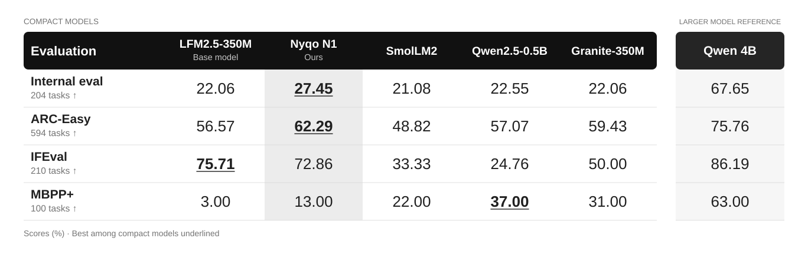

# Nyqo n1

<div style="display:flex; flex-wrap:wrap; align-items:center; gap:8px;">
  <a href="https://github.com/Hxtomi/nyqo" style="display:inline-flex;"></a>
  <a href="https://huggingface.co/Hxtomi/nyqo" style="display:inline-flex;"></a>
</div>

**Nyqo n1** is a compact, general-purpose language model with **497M parameters**. It uses a hybrid convolution–attention architecture and was post-trained on verified answers, using supervised fine-tuning and distillation from the base model and an earlier Nyqo checkpoint.

The goal was to improve the base model's overall task performance while keeping regressions in its existing capabilities within preset limits. This repository contains the training code, inference tools, and evaluation results.

| Model | Nyqo n1 |
|:--|:--|
| Parameters | 497,119,488 |
| Architecture | LFM2 hybrid, 24 layers |
| Base model | [LiquidAI/LFM2.5-350M](https://huggingface.co/LiquidAI/LFM2.5-350M) |
| Checkpoint format | Safetensors with Transformers configuration and tokenizer |
| Weights | Public Hugging Face release planned |
| Source license | [Apache 2.0](LICENSE) |
| Model card | [Nyqo n1 model card](MODEL_CARD.md) |

## Results



[Scores as a text table](docs/results.md#current-model-comparison)

With a limited compute budget, we evaluated fixed subsets of **ARC-Easy (594 tasks)**, **IFEval (210 tasks)**, and **MBPP+ (100 tasks)**. These are subset scores, not full-benchmark leaderboard results. **FINAL** is our separate internal evaluation of **204 tasks**.

The additional comparison scores are reported by the author as descriptive references; exact checkpoint IDs, revisions, and per-model inference records are not included in the release evidence.

For n1 and the base model, ARC-Easy is scored by normalized answer-choice likelihood, IFEval by strict prompt-level accuracy, and MBPP+ counts a task as solved only if it passes both the base and the additional tests.

For **n1 versus LFM2.5-350M**, the paired 95% confidence intervals for the ARC-Easy and MBPP+ gains lie entirely above zero. IFEval accuracy is lower, but the interval for that difference includes zero. These intervals apply to that base-model comparison; paired intervals for the additional models are not reported here. The n1 results cover a single post-training seed.

On FINAL, n1 scores **56/204**, versus **45/204** for the base model (**+24.44% relative; +5.39 percentage points**). This meets the project's acceptance criteria. The earlier internal bootstrap interval included zero, and no paired interval has been recomputed for the updated aggregate. Passing the project target should not be read as a statistically conclusive gain. Retention was also incomplete in the earlier item-level analysis: n1 retained 26 of the 45 tasks the base model solved.

[Evaluation protocols and detailed results](docs/results.md) · [Limitations](release/huggingface/README.md#limitations)

## Getting started

The [Hugging Face model page](https://huggingface.co/Hxtomi/nyqo) is prepared in a private repository. Checkpoint upload and a fresh-GPU loading check are pending. Until then, the checkpoint is stored in a private archive.

The current CLI runs a local checkpoint and requires **Python 3.12** and a **CUDA GPU with BF16 support**:

```bash
git clone https://github.com/Hxtomi/nyqo.git
cd nyqo
python -m pip install -r requirements.txt
```

The checkpoint files must be placed in `models/nyqo-n1`. If you have access to the private archive, download and verify them with:

```bash
python -m nyqo.download --output models/nyqo-n1
```

Then run generation:

```bash
python -m nyqo.generate --checkpoint models/nyqo-n1 \
  --prompt "Explain gradient descent in simple terms."
```

The CLI verifies file hashes, applies the model's native chat template, and uses the recorded BF16/SDPA profile. Its offline tests pass, but an end-to-end run in a fresh GPU environment has not been validated yet.

See the [usage guide](docs/usage.md) for authentication, multi-turn conversations, and generation settings.

## Training

Nyqo n1 expands LFM2.5-350M from 16 to 24 layers. The eight new layers are initialized so that the expanded model initially reproduces the original outputs; only these layers are then trained, while the original weights stay frozen. This amounts to **142,635,520 trainable parameters**.

Verified answers retained unchanged from the base model or the earlier K500 checkpoint receive both supervised and distillation losses. Corrected or external reference answers receive supervised loss only. For checkpoint selection, six domains are tracked separately: source use, instruction following, reasoning, knowledge, dialogue context, and code.

The selected checkpoint saw 800 training examples. The recorded n1 post-training runs used a single RTX 3060 with 12 GB of VRAM.

[Method and data](docs/method.md) · [Training code](research/original/)

## Documentation

- [Model card](MODEL_CARD.md): model details, evaluation, limitations, and loading instructions; also prepared for the Hugging Face model page.
- [Artifact inventory](artifacts/README.md): checkpoint files, archive locations, and available evaluation evidence.
- [Development priorities](docs/roadmap.md): evaluation and training work, plus preparation of the Hugging Face release.
- [License and attribution](docs/licensing.md): terms for the base model, project source, and data.

Developed by **Artur Markov-Tsoy**, building on Liquid AI's LFM2.5-350M. Evaluation relies on ARC, IFEval, and EvalPlus (MBPP+). Citation metadata is in [CITATION.cff](CITATION.cff).
